<div align="center">

# Cortex

**Le moteur de contexte code pour agents IA.**<br>
find, card, read, impact : un agent comprend une base de code en quelques appels et avec ~10 fois
moins de tokens que grep + lecture de fichiers. Local, instantané, open source.

[](https://github.com/AstroQuestStudio/cortex/actions/workflows/ci.yml)
[](https://github.com/AstroQuestStudio/cortex/releases/latest)
[](https://github.com/AstroQuestStudio/cortex/releases)
[](LICENSE)
[](#brancher-son-agent)

**par [AstroQuest](https://astroquest.fr)** · [astroquest.fr/cortex](https://astroquest.fr/cortex) · [English](README.md) · [Spécification](docs/SPEC.md) · [Bancs](docs/BENCHMARKS.md) · [Architecture](docs/ARCHITECTURE.md)

<picture>
  <source media="(prefers-color-scheme: dark)" srcset="docs/assets/demo-dark.svg">
  
</picture>

<sub>Une vraie session sur <a href="https://github.com/honojs/hono">hono</a> (421 fichiers), rejouée à partir des sorties de Cortex 0.3.0. Transcription complète <a href="#une-vraie-session">plus bas</a>.</sub>

</div>

---

Les agents de code dépensent l'essentiel de leurs tokens à *chercher* : grep, ouvrir un fichier,
grep encore, en ouvrir un autre. Cortex indexe le dépôt une fois (quelques secondes pour
10 000 fichiers), tient l'index à jour à chaque appel, et répond aux questions que se posent
vraiment les agents — *où est X, c'est quoi, qui l'appelle, qu'est-ce qui casse si je le change* —
par des sorties courtes et enchaînables.

## Installation

**Linux, macOS**

```sh
curl -fsSL https://raw.githubusercontent.com/AstroQuestStudio/cortex/main/install.sh | sh
```

**Windows (PowerShell)**

```powershell
irm https://raw.githubusercontent.com/AstroQuestStudio/cortex/main/install.ps1 | iex
```

Les deux scripts téléchargent le binaire de votre plateforme depuis la
[dernière release](https://github.com/AstroQuestStudio/cortex/releases/latest), **refusent de
l'installer si son SHA-256 ne correspond pas à `SHA256SUMS.txt`**, et ne demandent jamais de
droits administrateur : `~/.local/bin` sous Linux et macOS (le script signale si ce dossier
n'est pas dans le `PATH`, il ne modifie pas votre profil shell), `%LOCALAPPDATA%\cortex\bin`
sous Windows (ajouté au `PATH` *utilisateur*). À lire avant si vous le souhaitez :
[install.sh](install.sh), [install.ps1](install.ps1). Options : `CORTEX_INSTALL_DIR`,
`CORTEX_VERSION` (et `CORTEX_NO_MODIFY_PATH=1` sous Windows).

<details>
<summary>Binaires précompilés, ou compilation depuis les sources</summary>

| Plateforme | Archive (de la [dernière release](https://github.com/AstroQuestStudio/cortex/releases/latest)) |
|---|---|
| Linux x86_64 (glibc 2.35+ : Ubuntu 22.04, Debian 12 ou plus récent) | `cortex-x86_64-unknown-linux-gnu.tar.gz` |
| macOS Apple silicon | `cortex-aarch64-apple-darwin.tar.gz` |
| macOS Intel | `cortex-x86_64-apple-darwin.tar.gz` |
| Windows x86_64 | `cortex-x86_64-pc-windows-msvc.zip` |

Chaque archive contient le binaire `cortex`, le README, la licence et le changelog ; les sommes
de contrôle sont dans `SHA256SUMS.txt`. Depuis les sources (Rust stable et un compilateur C,
pour les grammaires tree-sitter) :

```sh
cargo install --locked --git https://github.com/AstroQuestStudio/cortex
```

Les paquets crates.io et npm (`astroquest-cortex`) sont prêts dans ce dépôt mais pas encore
publiés.

</details>

Puis indexer un projet et l'interroger :

```sh
cd mon-projet
cortex index . --name MonProjet     # quelques secondes ; l'index se tient ensuite à jour seul
cortex find "où sont signées les sessions"
```

## Mesuré, pas promis

**Banc public** : 60 questions sur [flask](https://github.com/pallets/flask) (Python),
[hono](https://github.com/honojs/hono) (TypeScript) et
[ripgrep](https://github.com/BurntSushi/ripgrep) (Rust) à des commits épinglés, écrites par des
personnes qui n'ont jamais vu une sortie de Cortex, avant tout passage de Cortex sur ces dépôts.
Même corpus, même juge pour chaque approche. Rejouable par tous :
[`bench/public/run.sh`](bench/public/run.sh).

| Approche | top-1 | top-5 | MRR | tokens lus avant le bon fichier (médiane par dépôt) |
|---|---:|---:|---:|---:|
| **graphify 0.8.38** (`graphify query`, meilleur de 5 réglages essayés) | 13,3 % | 35,0 % | 0,238 | pas de liste classée : ~1 500 tokens de graphe par question |
| grep par mots-clés (`rg`, fichiers classés par mots distincts) | 16,7 % | 58,3 % | 0,345 | 5 141 – 31 710 |
| BM25 sur les fichiers entiers | 50,0 % | 78,3 % | 0,625 | 8 – 22 |
| **Cortex 0.6.0** | **65,0 %** | **88,3 %** | **0,750** | non remesuré (14 – 29 avec la 0.5.1) |
| Cortex 0.5.1 | 63,3 % | 86,7 % | 0,737 | 14 – 29 |
| Cortex 0.5.0 | 56,7 % | 86,7 % | 0,702 | 14 – 29 |

Les références RAG dense (38,3 % / 68,3 %) et hybride (41,7 % / 81,7 %), mesurées avec Cortex 0.3.0
(elles demandent un modèle de 506 Mio), sont dans [docs/BENCHMARKS.md](docs/BENCHMARKS.md).

**Ce qui change en 0.6.0.** Le lot des questions françaises, les symboles SQL / YAML / TOML / JSON et
Kotlin donnent, sur les mêmes 60 questions, une moyenne de **65,0 % top-1 / 88,3 % top-5 / MRR 0,750**
(0.5.1 : 63,3 % / 86,7 % / 0,737). La hausse vient du lot français (65,0 / 88,3 / 0,751 à lui seul) ;
les symboles de configuration arrivés après ont déplacé le MRR moyen de 0,001 (hono 0,774 → 0,770,
top-1 et top-5 inchangés), du bruit à 20 questions par dépôt. Par dépôt le gain est inégal : flask
perd une question en top-5 (95 % → 90 %), ripgrep en gagne deux (75 % → 85 %). Banc français de 100
questions (`bench/public-fr`, écrit à l'aveugle) : dev 65,0 % → 73,3 % de top-1 (l'ensemble sur
lequel on a réglé), test 47,5 % → 55,0 % (top-5 inchangé à 82,5 % ; le test a été exécuté deux fois,
voir [docs/BENCHMARKS.md](docs/BENCHMARKS.md) section 4.2). Détail : [docs/BENCHMARKS.md](docs/BENCHMARKS.md)
section 4.

### Cortex contre graphify, face à face

Mêmes 60 questions, même juge (rang du premier fichier attendu, coupé à 20). graphify est construit
avec son propre `graphify update` et interrogé avec son propre `graphify query`, sur la même machine
(Ryzen 7 5800H, Windows 11). Pour être juste avec graphify, nous avons essayé cinq façons de
l'interroger (question naturelle ou mots-clés seuls, largeur ou profondeur, budget 2 000 ou 10 000
tokens) et retenu la meilleure : profondeur, mots-clés seuls. Son réglage par défaut (question
naturelle, largeur) donne 10,0 % / 30,0 % / 0,204. Rejouable : [`bench/public/graphify-bench.py`](bench/public/graphify-bench.py).

| | graphify 0.8.38 | **Cortex 0.5.1** | |
|---|---:|---:|---|
| top-1 / top-5 (60 questions) | 13,3 % / 35,0 % | **63,3 % / 86,7 %** | **4,8× / 2,5×** |
| MRR | 0,238 | **0,737** | 3,1× |
| Une question, processus complet | ~570 ms | **~24 ms** | **~24× plus vite** |
| Construire l'index (flask / hono / ripgrep) | 5–7 s / 14–16 s / 8–9 s | **moins de 0,4 s chacun** | 20× ou plus |
| Taille de la réponse | ~1 500 tokens | **~415 tokens** | 3,6× plus petite |
| On vient d'ajouter une fonction, on la demande | *No matching nodes found* tant qu'on ne relance pas `graphify update` | **trouvée en 18 ms** (vérification et réindexation du seul fichier dans l'appel) | toujours à jour |
| Impact de `parseFormData` dans hono | 4 nœuds, profondeur 2 par défaut, pas de liste de tests | **10 dépendants sur 3 niveaux, 4 tests à relancer** | |
| Clé d'API LLM | pour les docs et les liens sémantiques | **jamais** | 100 % local |

Ce que graphify a et pas Cortex : une page de graphe interactive (`graph.html`), la détection de
communautés et une couche sémantique pour docs, images et articles (elle demande un LLM ; les
chiffres ci-dessus sont son mode AST seul, celui que donnent `graphify update` et `graphify query`
sans clé d'API). Son `query` est un parcours du graphe fait pour explorer, pas un localisateur
classé « où est X », qui est la question de ce banc. Ce que Cortex a et pas graphify : une réponse
classée avec identifiants stables, `card`, `read` (les lignes exactes d'un symbole), `ask` (tout
pour une question en un appel sous budget), `grep` avec la fonction englobante, `ui` (du texte
affiché au code), les docs de bibliothèques hors ligne, un index qui se rafraîchit à chaque appel.

### Là où Cortex ne gagne **pas**

Les chiffres de la 0.5.1 viennent d'une passe qui n'a gardé que les changements n'abaissant aucun de
cinq jeux privés (voir [docs/BENCHMARKS.md](docs/BENCHMARKS.md) section 3) ; la 0.5.0 publiée fait
56,7 % / 86,7 % / 0,702 sur les mêmes questions. Limites honnêtes : le top-5 public n'a pas bougé
(86,7 %, ripgrep 75 %) ; les questions en français restent faibles sur les dépôts publics (flask
top-1 25 %, ripgrep top-5 25 %, avec 4 questions seulement par dépôt) ; et sur les **questions
vagues, reformulées**, sans mot commun avec le code, Cortex est faible (22,5 % en top-1, 27,5 % en
top-5 sur 40 questions aveugles) : un moteur lexical ne comble pas cela, il faut de la sémantique.
Avec 20 questions par dépôt, une question vaut 5 points : un écart de moins de deux questions est du
bruit.

**Vitrine réelle** : le monorepo propriétaire d'AstroQuest (8 069 fichiers, 1,7 M lignes de
TypeScript, Rust et SQL), questions cachées écrites avant tout réglage. Cortex 0.5.1 :
**70,3 % en top-1, 97,3 % en top-5** sur les 37 questions cachées (0.3.0 sur les mêmes : 59,5 % /
78,4 %), et 69 % / 87 % sur un jeu étendu de 100 questions (0.3.0 : 55 % / 80 %). Sur 37 questions
plus vagues : 29,7 % / 62,2 % (0.3.0 : 21,6 % / 45,9 %), et 22,5 % / 27,5 % sur un jeu aveugle de
40 reformulations. Références plus anciennes sur l'ancien jeu de 40 questions : BM25 sur fichiers
30 % / 57,5 %, RAG dense 25 % / 35 %, grep 7,5 % / 30 %.
Sur 10 tâches de compréhension d'agent (impact, flux
de données, vue d'un module, tests à relancer) : 86 % des faits couverts contre 89 % avec grep +
lecture, pour **10,9 fois moins de tokens et 40 % d'appels en moins**. Latence : `find` 5–9 ms,
`card` ~2 ms, `impact` ~2 ms, mise à jour d'un fichier modifié 7 ms, index complet ~5 s.

## Une vraie session

La session animée plus haut, en texte. Sur [hono](https://github.com/honojs/hono) (421 fichiers), un agent veut modifier l'analyse des
formulaires. Quatre appels, **~1 070 tokens** en tout :

```console
$ cortex find "where is the request body parsed as form data"
S:src/utils/body.ts#parseFormData fn L126-150 — Parses form data from a request.
S:src/request.ts#formData method L334-336 — Parses the request body as `FormData`.
…
next : card S:src/utils/body.ts#parseFormData

$ cortex card S:src/utils/body.ts#parseFormData
S:src/utils/body.ts#parseFormData fn L126-150
sig: async function parseFormData<T extends BodyData>( request: HonoRequest | Request, options: ParseBodyOptions ): Promise<T>
rôle: Parses form data from a request.
appelle 3 (+1 ambigu): S:src/utils/body.ts#isRawRequest, S:src/utils/body.ts#convertFormDataToBodyData, S:src/utils/buffer.ts#bufferToFormData
appelé par 1 (1 fichiers, L = ligne de l'appel): S:src/utils/body.ts#parseBody L112
tests: F:src/utils/body.test.ts
next : read S:src/utils/body.ts#parseFormData

$ cortex read S:src/utils/body.ts#parseFormData      # les lignes 126 à 150, numérotées
$ cortex impact S:src/utils/body.ts#parseFormData
impact S:src/utils/body.ts#parseFormData fn L126-150
10 dépendant(s) sur 3 niveau(x), 9 fichier(s)
tests à relancer 4: F:src/middleware/method-override/index.test.ts, F:src/request.test.ts, F:src/utils/body.test.ts, F:src/validator/validator.test.ts
…
```

Le même chemin par grep et lecture (grep « form data », lire `body.ts`, grep de ses appelants)
coûte **~9 000 tokens**, sans les dépendants transitifs ni les tests à relancer.

Chaque résultat porte un **identifiant stable** (`S:chemin#symbole`, `F:chemin`,
`D:doc#section`) que l'agent recopie dans l'appel suivant, une plage de lignes, et une dernière
ligne `next :` qui propose l'appel le plus utile ensuite. Format spécifié dans
[docs/SPEC.md](docs/SPEC.md).

## Brancher son agent

Cortex est un serveur [MCP](https://modelcontextprotocol.io) en stdio : `cortex mcp`.

- **Claude Code** : `/plugin marketplace add AstroQuestStudio/cortex` puis
  `/plugin install cortex@astroquest` (serveur MCP + skill `/cortex`), ou
  `claude mcp add --scope user cortex -- cortex mcp`.
- **Cursor** (`~/.cursor/mcp.json`), **Gemini CLI** (`~/.gemini/settings.json`) :
  `{ "mcpServers": { "cortex": { "command": "cortex", "args": ["mcp"] } } }`
- **Codex CLI** (`~/.codex/config.toml`) : `[mcp_servers.cortex]` avec `command = "cortex"` et
  `args = ["mcp"]`.
- **VS Code** (`.vscode/mcp.json`) :
  `{ "servers": { "cortex": { "type": "stdio", "command": "cortex", "args": ["mcp"] } } }`

## Les outils

| Outil (CLI / MCP) | La question de l'agent |
|---|---|
| `find` / `cortex_find` | Où est X ? (langage naturel FR ou EN, ou mots-clés) |
| `card` / `cortex_card` | C'est quoi : signature, rôle, appelés, appelants avec la ligne de l'appel, tests ? |
| `read` / `cortex_read` | Montre exactement cette fonction (ou section de doc, ou plage) ; pour un gros symbole, `--autour "<question>"` (MCP `around`, `max_lines`) ne rend que les lignes qui répondent |
| `outline` / `cortex_outline` | Que contient ce fichier ? |
| `overview` / `cortex_overview` | Comment marche ce dossier ? |
| `impact` / `cortex_impact` | Qu'est-ce qui casse si je change ça, quels tests relancer ? |
| `path` / `cortex_path` | Comment A arrive-t-il à B ? |
| `changed` / `cortex_changed` | Qu'ai-je modifié, qui l'appelle, quels tests ? |
| `grep`, `files`, `docs` | Texte exact avec la fonction englobante, fichiers par nom, docs hors ligne |
| `peek` / `cortex_peek` | Le bon endroit de N'IMPORTE QUEL gros texte (log de tests, sortie cargo, log serveur, JSON), indexé ou non : `cortex peek <fichier> "<question>"`, `--erreurs` pour les seuls blocs d'échec, sans question un résumé. Lit pareil le texte accentué ou non et la sortie de vitest, cargo, pytest, jest, `go test` et eslint ; `ask` lui passe les fichiers de log dont on parle |
| `edit` / `cortex_edit` | PLUSIEURS éditions en UN appel (le Code Mode pour tout agent qui a un shell, sous-agents compris) : remplacements exacts (ancre unique, tolérants à l'indentation), insertions de lignes, création de fichiers, remplacement d'un symbole par identifiant (`S:chemin#symbole`, avec les appelants à revérifier si la signature change), renommage mot entier dans tout le projet. Tout ou rien (toutes les erreurs d'un coup), CRLF/LF/BOM conservés fichier par fichier, régression de syntaxe et chemins secrets (`.env*`, `.secrets/`, `.git/`…) refusés, journalisé et annulable (`--annuler`), `--essai` pour prévisualiser. Format texte sans échappement (`@ fichier` / `< ancien` / `> nouveau`) ou JSON ; voir `docs/EDIT.md` | N appels `Edit` + un `Read` par fichier + des tours de correction |
| `trace` / `cortex_trace` | D'où vient cette erreur ? Une pile (texte de console Chrome/Firefox, Node/vitest/panique Rust, ou JSON de console de Spectra) en entrée ; les symboles source exacts en sortie, cartes de sources résolues (serveur de dev Vite, fichiers `.map`, `--maps dist/` hors ligne), code autour de la ligne, appelants et tests. Voir `docs/TRACE.md` | lire le fichier minifié ou transformé, deviner les lignes |
| `pack` / `cortex_pack` | De quoi ai-je besoin pour cette tâche ? Une description de tâche en entrée ; les fichiers probables (texte de la tâche + fichiers modifiés ensemble dans l'historique git), symboles clés avec appelants, tests, docs, changements récents et parcours Spectra en sortie, sous un budget (`-b`, 3000 par défaut), en identifiants réutilisables. Voir `docs/PACK.md` | find + overview + une dizaine de lectures |
| `impact --tests` / `cortex_impact` (`tests: true`) | Quels tests lancer pour ces changements ? Fichiers de test classés pour les fichiers non commités (ou `--depuis <ref>`, `--commit`, identifiants), la commande pour les lancer (`npm run test:resume -- …`, `cargo test …`) et, avec `--parcours`, les recettes Spectra dont les écrans dépendent du changement. Voir `docs/TESTS.md` | tout lancer, ou deviner |
| `registre` / `cortex_registre` | Plusieurs agents, une mission (`CORTEX_MISSION`) : `card`/`read` avec `--partage` répondent « déjà lu par l'agent X : résumé » pour ce qu'un pair a lu (fichier inchangé). Voir `docs/REGISTRE.md` | chaque agent relit les mêmes symboles |

Nouveautés de la 0.6.0 :

- **Questions en français** : table français → code (168 entrées), formes de base, locutions,
  négation (« sans X »). `CORTEX_FR=` (vide) les désactive pour comparer.
- **Langages** : Kotlin (`.kt .kts`, +4 Mo de binaire) ; symboles pour les fichiers SQL (tables,
  colonnes, policies RLS, fonctions, triggers, index, vues), YAML (CI, compose, OpenAPI,
  Kubernetes), TOML et JSON de configuration, classés à moitié poids sauf si la question les nomme.
  Banc SQL privé d'AstroQuest (20 questions) : top-1 30 % → 90 % ; surcoût d'index : environ
  +10,7 Mo pour 8 242 symboles SQL. tree-sitter 0.22 bloque encore Swift, PHP, Dart, Scala, Ruby,
  Zig et Svelte.
- **Cortex Web (expérimental, désactivé par défaut)** : `cargo build --release --features web`
  ajoute `cortex web …` et cinq outils MCP `cortex_web_*` (la doc de la version exacte de votre
  lockfile, reliée à votre code ; recherche web). Pas prêt pour la production : top-1 au niveau
  section de 36,1 % sur notre banc, pages JavaScript non lues, DuckDuckGo répond par une page de
  vérification. Voir [docs/WEB.md](docs/WEB.md).

## Personnaliser : le profil de projet (optionnel)

Cortex ignore le vocabulaire de VOTRE projet tant que vous ne le lui dites pas. Déposez un
`.cortex/profile.toml` à la racine du projet indexé (ou lancez `cortex profile init`, cinq secondes,
généré depuis les noms de dossiers et le README) : `[synonyms]` (mots que le projet emploie l'un pour
l'autre, ex. `facture = ["invoice"]`), `[penalty]` / `[boost]` (dossiers relégués ou favorisés,
multiplicateur du score), `[ignore]` (mots de question trop génériques), `[entry]` (fichiers
d'entrée). Il est relu à chaque `find` / `ask` (aucune réindexation), sans effet s'il est absent ;
`cortex profile check` liste ce qui a été compris. Les synonymes déclarés comblent un écart de
vocabulaire : ils s'appliquent aux mots de question rares dans le projet. Mesures honnêtes :
[docs/BENCHMARKS.md](docs/BENCHMARKS.md) section 3.

## Feuille de route

Ingesteurs git (`why`), SQL (`schema`) et docs ; I1 `ask` sous budget ; I2 contexte
différentiel ; I5 impact prédictif ; I8 faits vérifiables ; langages PHP,
Ruby, Swift (Kotlin est livré en 0.6.0) ; libellés de sortie en anglais et spécification v1.0. Détail dans le
[README anglais](README.md#roadmap).

## Contribuer, licence

Si Cortex fait économiser des tokens à votre agent, **mettez une étoile au dépôt** : c'est ainsi
que d'autres développeurs le trouvent. Voir [CONTRIBUTING.md](CONTRIBUTING.md) : des chiffres
avant et après chaque changement.
Licence [MIT](LICENSE) © 2026 [AstroQuest](https://astroquest.fr), qui s'en sert chaque jour sur
son propre monorepo de 8 000 fichiers.
