<div align="center">

# Cortex

**The code-context engine for AI agents.**<br>
Find, card, read, impact: an agent understands a codebase in a few calls and ~10× fewer tokens
than grep + read. Local, instant, open source.

[](https://github.com/AstroQuestStudio/cortex/actions/workflows/ci.yml)
[](https://github.com/AstroQuestStudio/cortex/releases/latest)
[](https://github.com/AstroQuestStudio/cortex/releases)
[](LICENSE)
[](#connect-your-agent)

**by [AstroQuest](https://astroquest.fr)** · [astroquest.fr/cortex](https://astroquest.fr/cortex) · [Français](README.fr.md) · [Spec](docs/SPEC.md) · [Benchmarks](docs/BENCHMARKS.md) · [Architecture](docs/ARCHITECTURE.md)

<picture>
  <source media="(prefers-color-scheme: dark)" srcset="docs/assets/demo-dark.svg">
  
</picture>

<sub>A real session on <a href="https://github.com/honojs/hono">hono</a> (421 files), replayed from Cortex 0.3.0 output. Full transcript <a href="#a-real-session">below</a>.</sub>

</div>

---

Coding agents spend most of their tokens *looking*: grep, open a file, grep again, open another.
Cortex indexes your repository once (seconds for 10,000 files), keeps the index fresh on every
call, and answers the questions agents actually ask — *where is X, what is it, who calls it,
what breaks if I change it* — with short, chainable outputs.

## Install

**Linux, macOS**

```sh
curl -fsSL https://raw.githubusercontent.com/AstroQuestStudio/cortex/main/install.sh | sh
```

**Windows (PowerShell)**

```powershell
irm https://raw.githubusercontent.com/AstroQuestStudio/cortex/main/install.ps1 | iex
```

Both scripts download the binary for your platform from the
[latest release](https://github.com/AstroQuestStudio/cortex/releases/latest), **refuse to install
it unless its SHA-256 matches `SHA256SUMS.txt`**, and never ask for administrator rights:
`~/.local/bin` on Linux and macOS (the script tells you if it is not on your `PATH`, it does not
edit your shell profile), `%LOCALAPPDATA%\cortex\bin` on Windows (added to your *user* `PATH`).
Read them first if you like: [install.sh](install.sh), [install.ps1](install.ps1). Options:
`CORTEX_INSTALL_DIR`, `CORTEX_VERSION` (and `CORTEX_NO_MODIFY_PATH=1` on Windows).

<details>
<summary>Prebuilt binaries, or build from source</summary>

| Platform | Archive (from the [latest release](https://github.com/AstroQuestStudio/cortex/releases/latest)) |
|---|---|
| Linux x86_64 (glibc 2.35+: Ubuntu 22.04, Debian 12 or newer) | `cortex-x86_64-unknown-linux-gnu.tar.gz` |
| macOS Apple silicon | `cortex-aarch64-apple-darwin.tar.gz` |
| macOS Intel | `cortex-x86_64-apple-darwin.tar.gz` |
| Windows x86_64 | `cortex-x86_64-pc-windows-msvc.zip` |

Each archive holds the `cortex` binary, the README, the license and the changelog; checksums are
in `SHA256SUMS.txt`. From source (Rust stable and a C compiler, for the tree-sitter grammars):

```sh
cargo install --locked --git https://github.com/AstroQuestStudio/cortex
```

The crates.io and npm packages (`astroquest-cortex`) are prepared in this repository but not
published yet.

</details>

Then index a project and ask it something:

```sh
cd your-project
cortex index . --name MyProject     # a few seconds; the index then refreshes itself
cortex find "where are sessions signed"
```

## Measured, not claimed

**Public benchmark**: 60 questions on [flask](https://github.com/pallets/flask) (Python),
[hono](https://github.com/honojs/hono) (TypeScript) and
[ripgrep](https://github.com/BurntSushi/ripgrep) (Rust) at pinned commits, written by people who
never saw Cortex's output, before Cortex was ever run on them. Same corpus, same judge for every
approach. Anyone can rerun it: [`bench/public/run.sh`](bench/public/run.sh).

| Approach | top-1 | top-5 | MRR | tokens read before the right file (median per repo) |
|---|---:|---:|---:|---:|
| **graphify 0.8.38** (`graphify query`, best of 5 settings tried) | 13.3% | 35.0% | 0.238 | no ranked list: ~1,500 tokens of graph per question |
| grep by keywords (`rg`, files ranked by distinct words) | 16.7% | 58.3% | 0.345 | 5,141 – 31,710 |
| BM25 over whole files | 50.0% | 78.3% | 0.625 | 8 – 22 |
| **Cortex 0.6.0** | **65.0%** | **88.3%** | **0.750** | not re-measured (14 – 29 with 0.5.1) |
| Cortex 0.5.1 | 63.3% | 86.7% | 0.737 | 14 – 29 |
| Cortex 0.5.0 | 56.7% | 86.7% | 0.702 | 14 – 29 |

The dense and hybrid RAG baselines (38.3% / 68.3% and 41.7% / 81.7% with Cortex 0.3.0; they need a
506 MiB model) are in [docs/BENCHMARKS.md](docs/BENCHMARKS.md).

**What changed in 0.6.0.** The French-question lot, SQL / YAML / TOML / JSON symbols and Kotlin
give, on the same 60 questions, a mean of **65.0% top-1 / 88.3% top-5 / MRR 0.750** (0.5.1:
63.3% / 86.7% / 0.737). The rise comes from the French-question lot (65.0 / 88.3 / 0.751 on its
own); the configuration symbols added after it moved the mean MRR by 0.001 (hono 0.774 → 0.770,
top-1 and top-5 unchanged), which is noise at 20 questions per repository. Per repository the gain
is uneven: flask lost one top-5 question (95% → 90%), ripgrep gained two (75% → 85%). On the
100-question French benchmark (`bench/public-fr`, written blind): dev 65.0% → 73.3% top-1 (the set
it was tuned on), test 47.5% → 55.0% (top-5 unchanged at 82.5%; the test set was run twice, see
[docs/BENCHMARKS.md](docs/BENCHMARKS.md) section 4.2). Details, including what is private and what
is not: [docs/BENCHMARKS.md](docs/BENCHMARKS.md) section 4.

### Cortex vs graphify, head to head

Same 60 questions, same judge (rank of the first expected file, cut at 20). graphify is built with
its own `graphify update` and queried with its own `graphify query`; both ran on the same machine
(Ryzen 7 5800H, Windows 11). To be fair to graphify we tried five ways of asking it (natural
question or keywords only, breadth-first or depth-first, budget 2,000 or 10,000 tokens) and report
the best: depth-first with keywords only. Its default (natural question, breadth-first) scores
10.0% / 30.0% / 0.204. Rerun it: [`bench/public/graphify-bench.py`](bench/public/graphify-bench.py).

| | graphify 0.8.38 | **Cortex 0.5.1** | |
|---|---:|---:|---|
| top-1 / top-5 (60 questions) | 13.3% / 35.0% | **63.3% / 86.7%** | **4.8× / 2.5×** |
| MRR | 0.238 | **0.737** | 3.1× |
| One question, whole process | ~570 ms | **~24 ms** | **~24× faster** |
| Build the index (flask / hono / ripgrep) | 7 s / 14 s / 9 s | **under 0.4 s each** | 20× or more |
| Answer size per question | ~1,500 tokens | **~415 tokens** | 3.6× smaller |
| You just added a function, then ask for it | *No matching nodes found* until you re-run `graphify update` | **found in 18 ms** (the check and the re-index of that one file happen inside the call) | always fresh |
| Impact of `parseFormData` in hono | 4 nodes, depth 2 by default, no list of tests | **10 dependents over 3 levels, 4 tests to rerun** | |
| Needs an LLM API key | for docs and semantic edges | **never** | fully local |

What graphify has that Cortex does not: an interactive graph page (`graph.html`), community
detection, and a semantic layer for docs, images and papers (it needs an LLM for that part; the
numbers above are its AST-only mode, which is what `graphify update` and `graphify query` give you
without an API key). Its `query` is a breadth-first walk of the graph meant for exploration, not a
ranked "where is X" locator, which is the question this benchmark asks. What Cortex has that
graphify does not: a ranked answer with stable ids, `card`, `read` (the exact lines of one
symbol), `ask` (everything for a question in one call under a token budget), `grep` with the
enclosing function, `ui` (from visible text to code), offline library docs, and an index that
refreshes itself on every call.

### Where Cortex does **not** win

The 0.5.1 figures come from a pass that kept only changes lowering none of five private sets (see
[docs/BENCHMARKS.md](docs/BENCHMARKS.md) section 3); the released 0.5.0 scores 56.7% / 86.7% /
0.702 on the same questions. Honest limits: public top-5 did not move (86.7%, ripgrep 75%); French
questions are still weak on the public repositories (flask top-1 25%, ripgrep top-5 25%, with only
4 questions per repository); and on **vague, paraphrased questions** that share no word with the
code, Cortex is weak (22.5% top-1, 27.5% top-5 on a 40-question blind set): a lexical engine cannot
close that, it needs semantics. With 20 questions per repository, one question is 5 points: a
difference under two questions is noise.

**Real-world showcase**: AstroQuest's proprietary monorepo (8,069 files, 1.7 M lines of
TypeScript, Rust and SQL), held-out questions written before any tuning. Cortex 0.5.1:
**70.3% top-1, 97.3% top-5** on the 37 held-out questions (0.3.0 on the same ones: 59.5% / 78.4%),
and 69% / 87% on a 100-question extended set (0.3.0: 55% / 80%). On 37 vaguer questions
29.7% / 62.2% (0.3.0: 21.6% / 45.9%), and 22.5% / 27.5% on a blind set of 40 paraphrases. Earlier
baselines on the former 40-question set: BM25 over files 30% / 57.5%, dense RAG 25% / 35%, grep
7.5% / 30%.
On 10 agent comprehension tasks (impact, data flow, module overview, tests to rerun), Cortex
covers 86% of the expected facts vs 89% for grep + read, with **10.9× fewer tokens and 40%
fewer calls**. Latency: `find` 5–9 ms, `card` ~2 ms, `impact` ~2 ms, update of one modified
file 7 ms, full index ~5 s.

## A real session

The session animated above, as text. On [hono](https://github.com/honojs/hono) (421 files), an
agent wants to change how form bodies are parsed. Four calls, **~1,070 tokens** in total:

```console
$ cortex find "where is the request body parsed as form data"
S:src/utils/body.ts#parseFormData fn L126-150 — Parses form data from a request.
S:src/request.ts#formData method L334-336 — Parses the request body as `FormData`.
S:src/utils/body.ts#convertFormDataToBodyData fn L160-189 — Converts form data to body data based on the provided options.
S:src/utils/body.ts#ParseBody interface L90-94 — Parses the body of a request based on the provided options.
…
next : card S:src/utils/body.ts#parseFormData

$ cortex card S:src/utils/body.ts#parseFormData
S:src/utils/body.ts#parseFormData fn L126-150
sig: async function parseFormData<T extends BodyData>( request: HonoRequest | Request, options: ParseBodyOptions ): Promise<T>
rôle: Parses form data from a request.
appelle 3 (+1 ambigu): S:src/utils/body.ts#isRawRequest, S:src/utils/body.ts#convertFormDataToBodyData, S:src/utils/buffer.ts#bufferToFormData
appelé par 1 (1 fichiers, L = ligne de l'appel): S:src/utils/body.ts#parseBody L112
fichier importé par 4 fichier(s)
tests: F:src/utils/body.test.ts
next : read S:src/utils/body.ts#parseFormData

$ cortex read S:src/utils/body.ts#parseFormData
S:src/utils/body.ts#parseFormData fn L126-150
126│async function parseFormData<T extends BodyData>(
127│  request: HonoRequest | Request,
…
150│}
next : impact S:src/utils/body.ts#parseFormData

$ cortex impact S:src/utils/body.ts#parseFormData
impact S:src/utils/body.ts#parseFormData fn L126-150
10 dépendant(s) sur 3 niveau(x), 9 fichier(s)
tests à relancer 4: F:src/middleware/method-override/index.test.ts, F:src/request.test.ts, F:src/utils/body.test.ts, F:src/validator/validator.test.ts
profondeur 1 — 1 (1 fichiers), L = ligne de l'appel
  S:src/utils/body.ts#parseBody L112
profondeur 2 — 3 (3 fichiers)
  F:src/middleware/method-override/index.ts
  F:src/request.ts
  …
next : read S:src/utils/body.ts#parseBody
```

The grep-and-read route to the same point (grep "form data", read `body.ts`, grep its callers)
costs **~9,000 tokens** and still does not give the transitive dependents or the tests to rerun.

Every result carries a **stable identifier** (`S:path#symbol`, `F:path`, `D:doc#section`) that the
agent copies into the next call, a line range, and a final `next :` (formerly `suite`) line with the most
useful next call. Output labels are French in v0.3 (`appelé par` = called by, `appelle` = calls);
the format is specified in [docs/SPEC.md](docs/SPEC.md).

## Connect your agent

Cortex is an [MCP](https://modelcontextprotocol.io) server over stdio: `cortex mcp`.

**Claude Code** — plugin (MCP server + `/cortex` skill):
```
/plugin marketplace add AstroQuestStudio/cortex
/plugin install cortex@astroquest
```
or the server alone: `claude mcp add --scope user cortex -- cortex mcp`

**Cursor** — `~/.cursor/mcp.json`:
```json
{ "mcpServers": { "cortex": { "command": "cortex", "args": ["mcp"] } } }
```

**Codex CLI** — `~/.codex/config.toml`:
```toml
[mcp_servers.cortex]
command = "cortex"
args = ["mcp"]
```

**Gemini CLI** — `~/.gemini/settings.json`:
```json
{ "mcpServers": { "cortex": { "command": "cortex", "args": ["mcp"] } } }
```

**VS Code** (agent mode) — `.vscode/mcp.json`:
```json
{ "servers": { "cortex": { "type": "stdio", "command": "cortex", "args": ["mcp"] } } }
```

Tell your agent to use Cortex before grep: the [skill](skills/cortex/SKILL.md) is a ready-made
instruction block you can paste into `AGENTS.md`, `CLAUDE.md` or your rules file.

## Tools

| Tool (CLI / MCP) | The agent's question | Replaces |
|---|---|---|
| `ask` / `cortex_ask` | Everything useful for a question in ONE call, under a token budget (`-b`, default 600): ids, signatures, callers, callees, tests, key lines | find then card then read |
| `find` / `cortex_find` | Where is X? (natural language, English or French, or keywords) | grep, find |
| `card` / `cortex_card` | What is this symbol: signature, role, callees, callers with call line, tests? | grep + reads |
| `read` / `cortex_read` | Show me exactly this function (or doc section, or line range); for a big symbol, `--autour "<question>"` (MCP `around`, `max_lines`) returns only the lines that answer it | Read with a guessed offset |
| `outline` / `cortex_outline` | What does this file contain (symbols, ranges, imports, importers, exports)? | reading the file |
| `overview` / `cortex_overview` | How does this folder work (entry points, dependencies, packages)? | ten reads |
| `impact` / `cortex_impact` | What breaks if I change this, and which tests to rerun? | repeated grep |
| `path` / `cortex_path` | How does A reach B (call chain with call lines)? | reading hop by hop |
| `changed` / `cortex_changed` | What did I change, who calls it, which tests? | git diff + grep |
| `grep` / `cortex_grep` | Exact text, grouped by file and enclosing function | rg |
| `peek` / `cortex_peek` | The right spot of ANY big text file (test log, cargo output, server log, JSON), indexed or not: `cortex peek <file> "<question>"`, `--erreurs` for failure blocks only, no question for a summary. Reads accented and unaccented text alike and the output of vitest, cargo, pytest, jest, `go test` and eslint; `ask` hands it the log files it is asked about | reading the whole log, tail, grep -C |
| `edit` / `cortex_edit` | MANY edits in ONE call (Code Mode for any agent with a shell, subagents included): exact replacements (unique anchor, tolerant to indentation), line insertions, file creation, whole-symbol replacement by id (`S:path#symbol`, with the callers to recheck if the signature changed), project-wide whole-word rename. All-or-nothing (every error listed at once), CRLF/LF/BOM kept per file, syntax regressions and secret paths (`.env*`, `.secrets/`, `.git/`…) refused, journaled and undoable (`--annuler`), `--essai` previews. Escape-free text format (`@ file` / `< old` / `> new`) or JSON; see `docs/EDIT.md` | N `Edit` calls + a `Read` per file + correction turns |
| `files` / `cortex_files` | A file by name fragment or glob | find, Glob |
| `docs` / `cortex_docs` | Offline docs of a library you scraped (`cortex docs add <url>`) | web search |

`ask` picks its facts greedily by value per token, with a redundancy penalty, and routes questions
that name a symbol, two code targets or a folder to `impact`, `path` or `overview`. On the bundled
agent benchmark it reads about a third fewer tokens than `find` then `card` then `read`, in one call
instead of two or three, for the same facts covered (`cortex bench-agent`, `ask` arm).

## Make it yours: the project profile (optional)

Cortex knows nothing about YOUR vocabulary until you tell it. Drop a `.cortex/profile.toml` at the
root of the indexed project (or run `cortex profile init`, five seconds, generated from your folder
names and README):

```toml
[synonyms]                       # words this project uses for the same thing
facture = ["invoice", "billing"] # a French word that never appears in the code
[penalty]                        # folders that rarely answer a feature question
"vendor/" = 0.4
"examples/" = 0.6
[boost]                          # folders that hold the product code
"src/core/" = 1.2
[ignore]
terms = ["application"]          # question words that match everywhere here
[entry]
files = ["src/main.rs"]          # entry points, favoured by x1.05
```

It is read on every `find` / `ask` (no re-index), has no effect when absent, and `cortex profile
check` lists what was understood. Declared synonyms fill a vocabulary gap: they apply to question
words that are rare in the project (`always = true` in `[synonyms]` applies them everywhere). Folder
rules are multipliers on the score. What it is worth, measured honestly, is in
[docs/BENCHMARKS.md](docs/BENCHMARKS.md) section 3: safe and neutral when written blind, with no measured
gain on our benchmarks (their questions already use the words of the code). It is meant for the
words your team says that the code does not contain. Format: [docs/SPEC.md](docs/SPEC.md) section 4.11.

## Why not grep, embeddings or a language server?

- **grep** matches words, not meaning, and returns every line that contains them: agents read
  thousands of tokens of matches before they see the right file. Cortex ranks *symbols* with
  BM25F over names split from camelCase/snake_case, paths, doc comments, file headers and file
  bodies, with stemming and an English↔French glossary.
- **Embeddings / RAG** need a model (hundreds of MB), a vector store and re-embedding on every
  change, and return chunks of code instead of locations. On both benchmarks they rank worse
  than Cortex.
- **Language servers** are precise but per-language, heavy to start, and answer editor
  questions (go to definition) rather than agent questions (what is this area of the code, what
  breaks). Cortex resolves calls through real imports (an ambiguous call is counted, never
  guessed) across languages, from one index.
- **Always fresh**: every call checks file sizes and dates (tens of ms on 8,000 files, no git
  needed) and re-indexes only what changed, as a small delta segment. No daemon, no watcher to
  configure, no external service: everything stays on your machine.

Languages: TypeScript/TSX, JavaScript, Python, Rust (calls, methods and type references; `use` and
`pub use` resolved across the crates of a workspace), C#, C and C++ (`.h .hpp .hh .hxx .inl .c .cc .cpp .cxx`,
Unreal Engine macros included), Lua (`.lua`: Recoil / Beyond All Reason widgets and gadgets, definition
tables, GLSL embedded in strings), GLSL (`.glsl .vert .frag .geom .comp`), Go, Java, shell scripts
(symbols only for the last three), Markdown (tree-sitter).

New in 0.6.0: Kotlin (`.kt .kts`, +4 MB of binary) and symbols for
SQL (tables, columns, RLS policies, functions, triggers, indexes, views), YAML (CI, compose,
OpenAPI, Kubernetes), TOML and JSON config files, ranked at half weight unless the question names
them (on AstroQuest's private SQL benchmark, 20 questions: top-1 30% → 90%; about +10.7 MB of index
for 8,242 SQL symbols). tree-sitter 0.22 still blocks the Swift, PHP, Dart, Scala, Ruby, Zig and
Svelte grammars; upgrading is estimated at 1.5 to 3 days (not measured), see
[docs/BENCHMARKS.md](docs/BENCHMARKS.md) section 4.6.

## More

- **Offline docs**: `cortex docs add https://react.dev/reference --name React` scrapes a doc site
  into local markdown, searchable with `cortex docs query` / `cortex_docs`. Batch mode with a live
  dashboard: `cortex docs batch examples/docs-example.txt`.
- **3D viewer**: `cortex viewer` renders every indexed project and doc set as a galaxy.
- **Cortex Web (experimental, off by default)**: `cargo build --release --features web` adds
  `cortex web …` and five `cortex_web_*` MCP tools (the docs of the exact library version in your
  lockfile, linked to your code; web search). Not ready for production: section-level top-1 is 36.1%
  on our benchmark, pages that need JavaScript are not read, and DuckDuckGo answers with a
  verification page. See [docs/WEB.md](docs/WEB.md).
- **Multi-project**: every tool searches all enabled projects, or one with `-p <Project>`;
  `cortex config disable <Project>` keeps a project out of global searches.
- **Data**: `~/.cortex/` (override with `CORTEX_HOME`), one atlas per project: immutable
  memory-mapped segments plus small delta segments ([architecture](docs/ARCHITECTURE.md)).

## Roadmap

Public, in the order we expect to build it. Every item ships with a benchmark that proves it.

- **Ingesters**: git history (`why <id>`: who changed this and why), SQL schemas (`schema
  <table>`: columns, policies, who reads and writes it), docs linked to the code they mention.
- **I1 — `ask` under a budget** (first version shipped, rule-based): one call assembles the best set of facts (definition, callers,
  tests; next: docs, commits, learned weights) for a question within N tokens.
- **I2 — differential context**: the MCP server remembers what it already sent in a session and
  sends only what changed.
- **I5 — predictive impact**: call graph × co-change history, ranked by risk.
- **I8 — verifiable facts**: each fact carries a content hash so an agent can check it is still
  true without re-reading the file.
- **Languages**: PHP, Ruby, Swift (Kotlin shipped in 0.6.0; the others need tree-sitter 0.25, see [docs/BENCHMARKS.md](docs/BENCHMARKS.md) section 4.6); call graph for Go, Java and shell.
- **English output labels** and a stable v1.0 of the [specification](docs/SPEC.md).

## The specification

Cortex's identifiers, tools and output formats are an **open specification**
([docs/SPEC.md](docs/SPEC.md), v0.1 draft): any code-intelligence engine can implement it, and
agents, prompts and benchmarks written for one implementation work with the others.

## Contributing

If Cortex saves your agent some tokens, **star the repository**: it is how other developers find
it. Issues and pull requests are welcome: see [CONTRIBUTING.md](CONTRIBUTING.md). The one rule is
*numbers before and after*. Found a question Cortex answers badly on an open-source repository?
Open a **"Cortex missed"** issue — misses become benchmark questions.

## License

[MIT](LICENSE) © 2026 [AstroQuest](https://astroquest.fr). Cortex is built and maintained by
AstroQuest, which uses it every day on its own 8,000-file monorepo.
